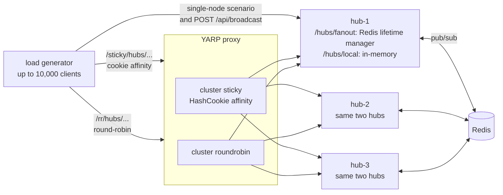
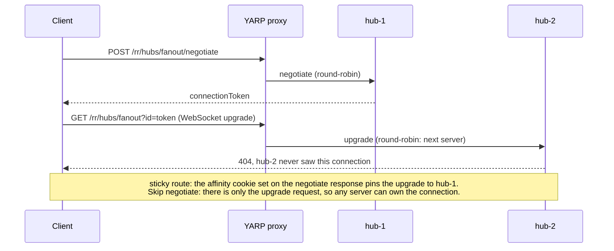

# signalr-scale-lab

[](https://github.com/hekimcan206/signalr-scale-lab/actions/workflows/ci.yml)
[](https://github.com/hekimcan206/signalr-scale-lab/actions/workflows/codeql.yml)


[](LICENSE)

Scaling ASP.NET Core SignalR past one server, measured. Three hub servers behind a YARP reverse proxy, a Redis
backplane, and a load generator that ramps to **10,000 concurrent WebSocket connections** and records what every
topology costs in memory and broadcast latency, and what it gets wrong.

The usual advice is "add a Redis backplane" or "turn on sticky sessions", as if they were alternatives. They fix two
different failures, and this repository shows both failures and both fixes on one deployment:

- **Sticky sessions without a backplane**: every connection opens, but a broadcast reaches only the clients of the
  server that sent it: **33.3%** of them with three servers.
- **A backplane without sticky sessions**: broadcasts would reach everyone, but **two thirds of the connections never
  open** (HTTP 404), because SignalR's negotiate request and the WebSocket that follows land on different servers.
- **Both**, or a backplane with clients that **skip negotiation**: everything works. The second needs no affinity.

> All data is synthetic: messages are sequence numbers and filler strings. There is no personal or business data.

## Results

Median of 3 runs per scenario, every scenario at 1,000 / 2,500 / 5,000 / 10,000 connections, on a shared Docker
Desktop VM (16 CPUs, 7.6 GB; hub servers limited to 2 CPUs and 1 GB each). **All five scenarios reached 10,000
concurrent connections in every run**, with no dropped connections; the test did not have to be scaled down.

| At 10,000 connection attempts | single node | sticky, no backplane | sticky + Redis | round-robin, negotiate | round-robin, skip negotiate + Redis |
|---|---:|---:|---:|---:|---:|
| Connections open | 10,000 | 10,000 | 10,000 | **3,270** | 10,000 |
| Broadcast reaches (of connected) | 100% | **33.3%** | 100% | 100% | 100% |
| Broadcast latency p50 / p99 | 93 / 223 ms | 32 / 88 ms * | 115 / 245 ms | 30 / 74 ms * | 112 / 271 ms |
| Hub server memory per connection (RSS) | 28.8 KiB | 32.9 KiB | **49.1 KiB** | n/a ** | **48.6 KiB** |
| Hub managed heap per connection | 23.8 KiB | 23.5 KiB | 28.4 KiB | n/a ** | 27.7 KiB |
| Proxy memory per connection (RSS) | no proxy | 35.4 KiB | 37.6 KiB | n/a ** | 32.8 KiB |

\* Only about 3,300 clients receive each broadcast in these two topologies, so their latency is not comparable with
the 10,000-receiver columns. \** 6,730 failed attempts distort per-connection memory; see the summary table.

What the numbers say:

- **The Redis backplane costs about 16 KiB of RSS (4-5 KiB of managed heap) per connection on the hub servers**,
  because `RedisHubLifetimeManager` subscribes one Redis channel per connection: 2,000 connections, 2,009 channels.
- **Sticky sessions cost nothing measurable** over the affinity-free topology, in memory or latency. Their price is
  operational (a cookie-aware proxy, uneven load after scale-out), not per connection.
- **The proxy costs about as much memory per connection as a hub server** (33-38 KiB): every proxied WebSocket is two
  TCP connections in YARP.
- **Broadcast latency follows the number of receivers, not the number of servers.** One server sending to 10,000 clients
  and three servers sending to 3,333 each through the proxy and Redis land in the same range. At 1,000 clients the
  Redis-and-proxy hop adds about 3 ms to the p50 (7.0 -> 9.8 ms).


More charts (memory per connection, p99), the full table for every stage, the method, host load and the experiments
behind the readings: [docs/benchmarks.md](docs/benchmarks.md). The table and charts are generated from the committed
run files, and CI fails if they drift.

## How it works





The pieces:

- **`ScaleLab.HubServer`**: two hubs side by side. `/hubs/fanout` uses the Redis backplane; `/hubs/local` keeps the
  in-memory lifetime manager on the same server (a closed `HubLifetimeManager<LocalHub>` registration overrides the
  backplane's open generic one). A key-protected API to broadcast and to read process stats after a forced full GC.
- **`ScaleLab.Proxy`**: YARP with a sticky route and a round-robin route to the same servers, built in code.
- **`ScaleLab.LoadGen`**: thousands of `HubConnection`s in staged ramps, lock-free fan-out accounting on one monotonic
  clock, a `demo` that checks every topology, `bench` that records a run, `report` that renders the table and charts.
- **`ScaleLab.Core`**: the scenario catalogue, `FanoutLedger`, nearest-rank statistics, aggregation and the SVG charts.
  No I/O.
- **`ScaleLab.Hosting`**: structured JSON logs (Serilog), optional OpenTelemetry metrics over OTLP, the lab key check.

## Why this design

Each decision has an ADR with the options that lost.

- **Backplane and affinity are different problems, measured on one deployment**
  ([ADR 0001](docs/adr/0001-backplane-and-affinity-are-separate-problems.md)). Two hubs per server and two routes in
  one proxy give all five topologies with identical processes, so the comparison isolates the variable.
- **YARP with HashCookie affinity** ([ADR 0002](docs/adr/0002-yarp-with-hashcookie-affinity.md)). `ip_hash` would pin
  every load-generator connection to one server; a cookie is what real browsers carry.
- **Skip negotiation as the affinity-free option, with its costs**
  ([ADR 0003](docs/adr/0003-skip-negotiation-instead-of-affinity.md)): no transport fallback, no negotiate-time
  features, tokens in the upgrade URL.
- **One load-generator process, one clock, forced-GC snapshots** ([ADR 0004](docs/adr/0004-measurement-method.md)).
  Latency needs one clock; memory per connection needs garbage collected first; the client shares one negotiate pool
  so idle negotiate sockets do not inflate the proxy's memory.
- **Real sockets, real Redis, reproducible report** ([ADR 0005](docs/adr/0005-testing-strategy.md)).

## Quick start

Requirements: Docker. For the tests and the report, .NET SDK 10.0.400 or later.

```bash
docker compose up --build
```

The load generator runs every scenario with 300 clients and checks it against the topology's expected behaviour:

```text
SignalR scale-out demo: 3 hub servers behind a YARP proxy, Redis backplane, 300 clients per scenario

scenario          connected  delivery   p50 ms   p99 ms  per server              verdict
single           300/300       100.0%      4.6     42.6  hub-1=300 hub-2=0 hub-3=0 ok: expected connect 100%, delivery 100%
sticky-only      300/300        33.3%      3.1      5.8  hub-1=100 hub-2=100 hub-3=100 ok: expected connect 100%, delivery ~33%
sticky-redis     300/300       100.0%      7.8     29.9  hub-1=100 hub-2=100 hub-3=100 ok: expected connect 100%, delivery 100%
rr-negotiate     104/300       100.0%      2.9      4.1  hub-1=33 hub-2=34 hub-3=37 ok: expected connect ~33%, delivery 100%
rr-skip          300/300       100.0%      3.1      6.2  hub-1=100 hub-2=100 hub-3=100 ok: expected connect 100%, delivery 100%

{"demo":"signalr-scale-lab","servers":3,"connections":300,"allAsExpected":true,"outcomes":[...]}
```

While the stack runs (ports bound to 127.0.0.1, key from `.env.example`):

| | |
|---|---|
| `curl -H 'X-Lab-Key: lab-dev-only' localhost:58481/api/stats` | hub-1: connections per hub, RSS, heap, backplane on/off |
| `curl -X POST -H 'X-Lab-Key: lab-dev-only' "localhost:58481/api/broadcast/fanout?seq=1"` | broadcast to every fan-out client on every server |
| `ws://localhost:58480/sticky/hubs/fanout` | connect a client of your own through the sticky route (client method `tick`) |
| `docker compose run --rm loadgen bench --scenario sticky-redis --stages 1000,5000` | one bench run, JSON on stdout |
| `bench/run-matrix.sh` | the full matrix (about 25 minutes), results in `benchmark-results/runs/` |

`docker compose down` removes everything.

Tests and the report:

```bash
dotnet test                                                     # unit, property, golden + Testcontainers (Docker)
dotnet run -c Release --project src/ScaleLab.LoadGen -- report --env "$(cat benchmark-results/environment.txt)"
```

## Testing

- **Integration** (Testcontainers Redis 7.4.11, two hub servers and the proxy on real Kestrel sockets): the backplane
  reaches clients on both servers; the in-memory hub on the same servers does not; the sticky route connects every
  negotiating client and spreads them; round-robin without affinity fails every negotiated connection,
  deterministically; skipping negotiation needs no affinity; the API key, input validation, stats and a miniature bench
  run end to end.
- **Unit and property** (FsCheck): percentiles are observed values and monotonic; delivery accounting under concurrent
  receives; chart axis ticks and label placement; proxy configuration (affinity on the sticky cluster only).
- **Golden**: the summary table and all five charts for a fixed synthetic data set.
- **CI**: build with warnings as errors, vulnerable-package audit, format check, tests with coverage, the committed
  report regenerated from the committed runs (`git diff --exit-code`), container images checked for a non-root user, the
  compose demo with its assertions and a bench smoke run, CodeQL.

## Limitations and next steps

- **One VM, no real network.** Clients, proxy, servers and Redis share the same physical CPUs and a Docker bridge.
  Absolute latencies would be higher across real hosts and CPU contention lower. Treat the latency numbers as relative.
- **Latency includes the client.** It is measured from the broadcast request to the client callback in one load
  generator process. A check with twice the client CPUs did not change it, but this is not a pure server measurement.
- **10,000 connections is the ceiling tested, not a limit found.** More was not attempted on the shared VM: at 10,000
  the proxy held about 470 MiB and the load generator about 700 MiB.
- **YARP only.** A C proxy (nginx, HAProxy, Envoy) would show different proxy memory and latency.
- **`Clients.All` only.** Group and user sends, client-to-server traffic, reconnect storms after a server loss and
  Redis failover are not measured. The Redis backplane does not buffer: during a Redis outage remote clients miss
  messages, and the lab does not yet show that curve.
- **Security is lab-grade**: anonymous hubs, a shared key on the API, Redis without password or TLS. The
  [threat model](docs/threat-model.md) lists what production needs.
- Next: a Redis-outage scenario, a server-loss reconnect storm under affinity vs skip-negotiate, and nginx as a second
  proxy.

## Privacy

No personal data is processed or stored. Messages are synthetic, connections are anonymous, and logs contain node
names and counts only (request logging is off).

## License

[MIT](LICENSE)
